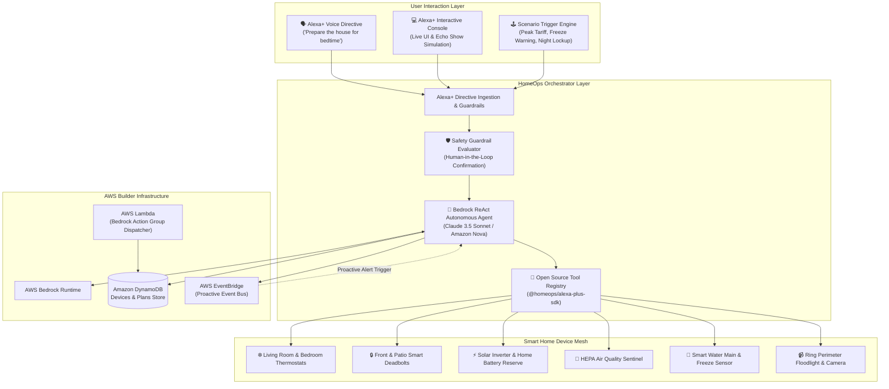

# HomeOps System Architecture

> Autonomous Smart Home Operations Agent for Amazon Alexa+ backed by AWS Bedrock, DynamoDB, EventBridge, and Open Source SDK.

---

## 🏗️ High-Level System Architecture



---

## 🧠 The ReAct Multi-Step Autonomous Reasoning Loop

Unlike traditional Alexa skills that rely on single-turn slot matching, HomeOps uses a **Thought -> Action -> Observation -> Final Answer** cycle:

```mermaid
sequenceDiagram
    autonumber
    actor User as Resident / Alexa+
    participant Brain as Bedrock ReAct Engine
    participant Safety as Safety Guardrail
    participant Tools as HomeOps Tools
    participant Device as Smart Home Device Mesh
    participant DB as DynamoDB & EventBridge

    User->>Brain: "Electricity rate just spiked into peak hours. Save me money."
    Brain->>Brain: Thought: Need to diagnose current household draw & utility tariff tier.
    Brain->>Tools: Action: diagnose_system_anomalies(domain: 'energy')
    Tools->>Device: Read battery % and current grid pricing ($0.48/kWh)
    Device-->>Tools: Status: Peak Surge Tier active
    Tools-->>Brain: Observation: Household drawing 1.2kW, battery at 78% charge.

    Brain->>Brain: Thought: Safe to activate battery peak-shaving and curtail HVACs to Eco mode.
    Brain->>Safety: Evaluate action impact (Impact: Low/Safe)
    Safety-->>Brain: Approved (No intrusive confirmation needed)
    Brain->>Tools: Action: optimize_energy_draw(mode: 'battery_peak_shaving')
    Tools->>Device: Throttle HVAC compressors & discharge 1.2kW battery
    Device-->>Tools: Success: Grid draw dropped to 0kW
    Tools-->>Brain: Observation: Grid draw eliminated; estimated 62% savings.

    Brain->>DB: Persist Plan & Emit EventBridge Alert
    Brain-->>User: Spoken Response: "I have engaged battery discharge to buffer peak rates and adjusted climate to Eco mode. Saving you 62% on grid power."
```

---

## 🛡️ Autonomous Safety & Guardrails System
- **Tier 1 (Safe Autonomous)**: Diagnostics, eco climate adjustments, air purifier turbo cleanses, solar battery peak shaving.
- **Tier 2 (Perimeter Security Lock)**: Locking doors and arming sensors automatically execute with immediate verbal and telemetry verification.
- **Tier 3 (High Consequence / Destructive)**: Unlocking deadbolts, disarming emergency systems, or water valve overrides require human-in-the-loop voice confirmation.
